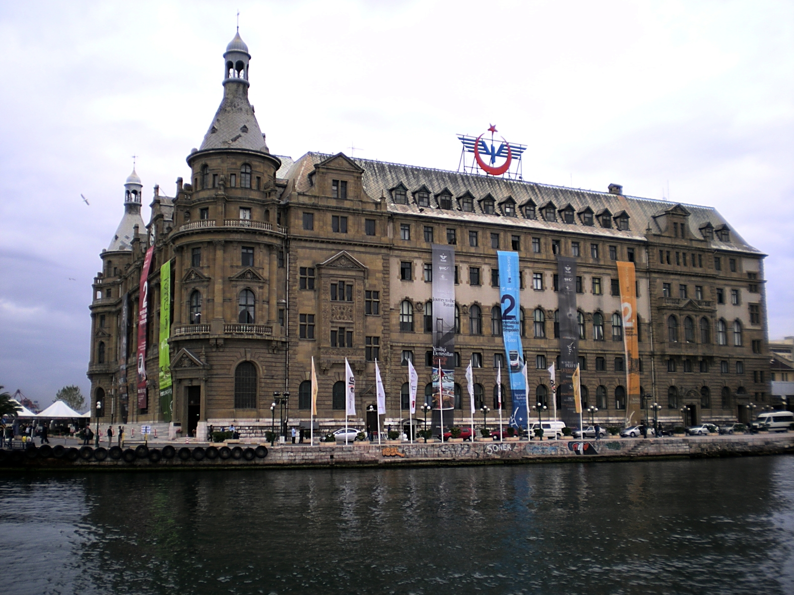
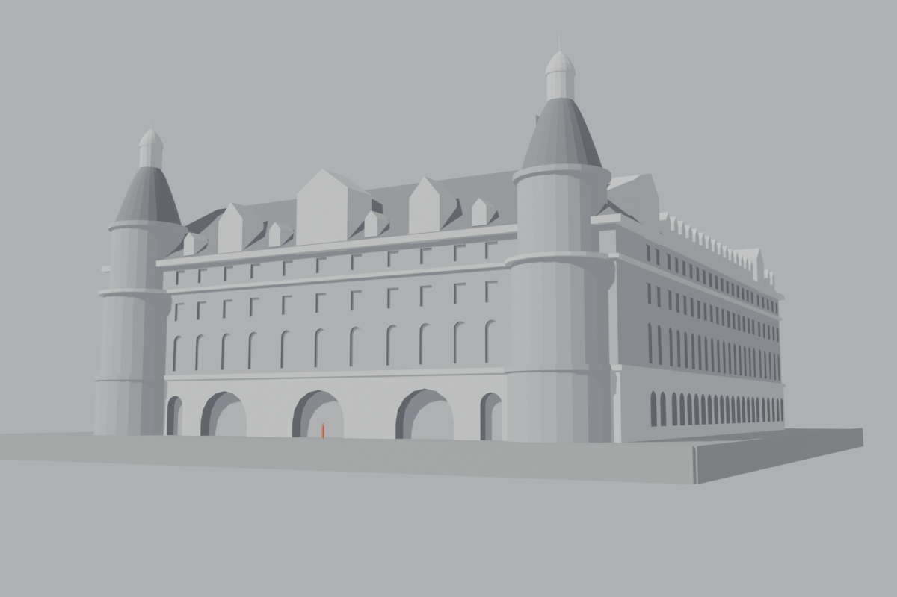
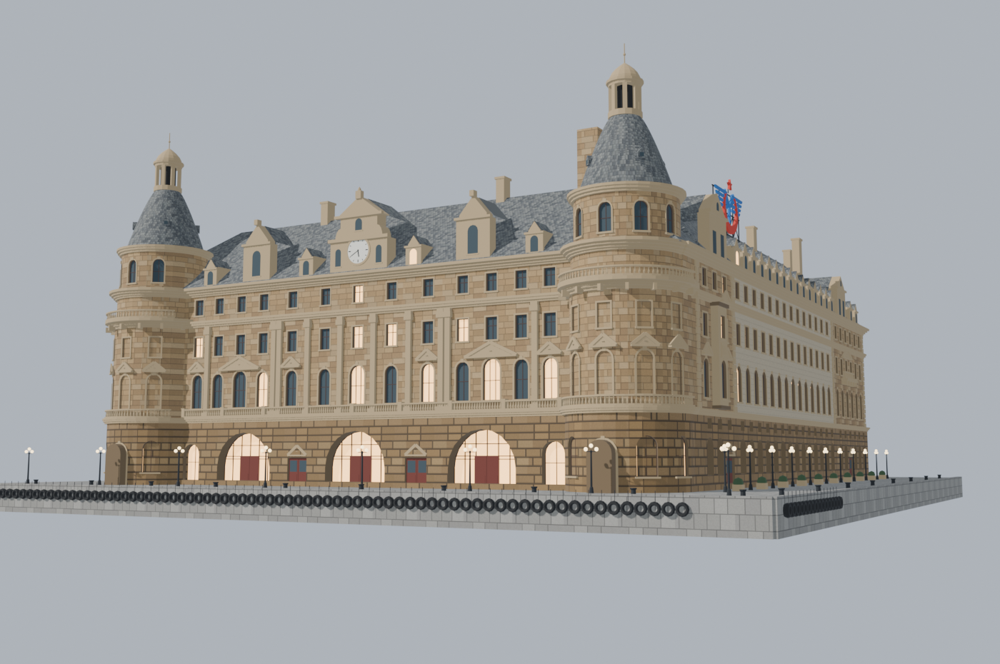
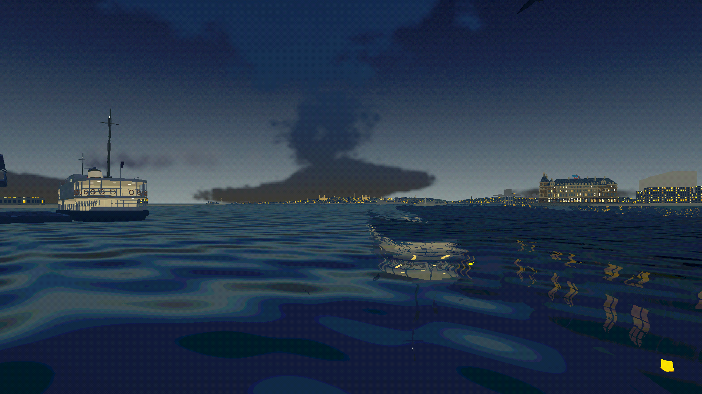
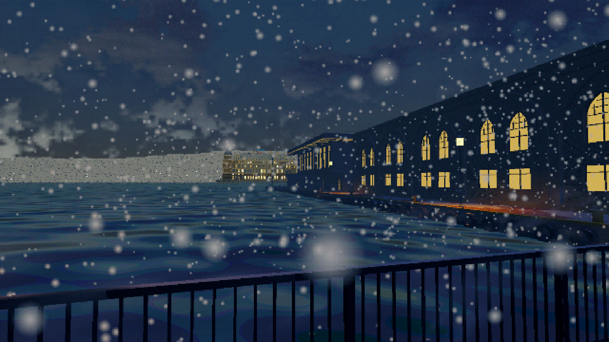

Hi,

Project R is set on the Kadıköy quay in Istanbul, in February 2008. Stand on the quay, look to the right across the water, and there's Haydarpaşa: the big station on the point, with the two pointed towers, where the trains to Anatolia started.

It's the one building on that side of the water everybody in Kadıköy knows. It's also one that no longer looks like this. On 28 November 2010 a fire took its roof and its fourth floor. The building has been repaired since, but the game is set two and a half years before the fire, so the station in it has to be the one from before.

## Only photos from before November 2010

That rule did most of the research. A photo of Haydarpaşa from 2012 shows a burnt roof or scaffolding. One from today shows the restoration. Neither is any use.

What I could use came from Wikimedia Commons: twenty-five photos taken between 2005 and 2010, each with its licence written down next to it. Most are Creative Commons, and three are in the public domain. One of those three is this one, taken from a Kadıköy ferry in October 2008, the same year as the game:

*Photo: "Kadıköy vapurundan Haydarpaşa'ya bakış", 24 October 2008, Wikimedia Commons, public domain.*

The history is short and well known. Haydarpaşa was built from 1906 to 1908, to designs by the German architects Otto Ritter and Helmuth Cuno. It stands on reclaimed ground, on about 1,100 timber piles, each 21 metres long.

## The plan comes from the map, the height from one photo

For the shape of the building on the ground I didn't need a photo. OpenStreetMap has its footprint, and it's accurate: 3,836 square metres, a U facing the sea. I took that outline as it was and built up from it.

Height was harder. Photos lie about height, because everything leans away from the lens. But one photo, from June 2009, was taken from far out on the water, almost straight at the seaward front. In a shot like that the lean nearly disappears, and you can measure the building with a ruler: 12.8 pixels to a metre. That photo became the height source for everything. The main block is 71.5 by 19.6 metres. The centre of the clock sits 24.8 metres up and is 3.1 metres across. The top of the tower lantern is at 43.4 metres.

The model went through three passes. First a blockout, just boxes at the right sizes, to check the proportions against the photos:

Then the second pass, the grey model at the top of this post, with the bays, the pediments, the dormers, the clock and the roof.

And then the third, with stone, plaster and slate:

The windows, doors, dormers and balustrades are all copies of a few master pieces. Change the master and all 470 windows change with it.

## Finding the sign by finding the camera

In 2008 a big TCDD sign stood on the roof, the logo of the state railways, red and blue on a steel frame. You can see it in the 2007 photos taken from the water. But where exactly was it on the roof? A photo taken at an angle doesn't tell you that directly.

So I worked the camera out backwards. I picked eight points I already knew in 3D from the map and the height photo, things like the corners of the towers and the top of the cornice, and found the same eight points in a photo from June 2007. With eight pairs like that, a small least-squares solver can find where the camera must have been standing, which way it was pointing and how long its lens was. The fit is off by about 12 pixels on average, in a picture 1,640 pixels wide, and that's close enough. It puts the photographer about 115 metres out from the building and about six metres above the ground the station stands on. That's roughly the height of a ferry deck.

With that camera in Blender, I could look through the same lens at the model and slide the sign until it sat where it sits in the photo. It ended up on the near slope of the south wing, about 10.6 metres wide and 8.7 metres tall.

## Lit windows and a stopped clock

Haydarpaşa is never seen up close in the game. It's across the water, and most of the time you look at it from the Kadıköy side, across the bay. So what matters is what reads from there: the outline of the towers, the bands of the floors, and at night, the windows.

Of the 470 windows, 161 are lit after dark.

The clock on the gable shows twenty to six, and it stays that way.

## Putting it back where it belongs

The first version stood about where it looked right from the quay, a little too big, on top of a grey slab of land. Behind it rose a hill 85 metres tall and 1.4 kilometres wide that doesn't exist. Across the water from Kadıköy there's no hill. There's the old city, four to six kilometres away, a thin line on the horizon with the domes of Hagia Sophia and the Blue Mosque just about visible on a clear day.

When I rebuilt the whole far shore from map and elevation data, Haydarpaşa had to fit with everything else. It turned 22 degrees, shrank from one and a half times to its real size, and moved 85 metres to the right, onto its real footprint. The fake hill went. Around it, the empty grey ground filled in with the container port and its cranes, because in 2008 Haydarpaşa was still a working port, not an empty lot.

The weather reaches it too now. On a clear day the station is sharp. On an overcast day it goes soft. In fog it disappears completely, the way it really does from the Kadıköy side.

## Optimization

Haydarpaşa is about 106,000 triangles, in one mesh, with no LOD. For something you only ever see from more than half a kilometre away, that's more than it needs.

When I counted where they go, about a quarter of them are in things you can't make out from the Kadıköy side: 83 tyre fenders along the quay (about 13,000 triangles), the balustrades on the waterfront and the two towers (about 10,600) and 18 street lamps (about 5,200). From across the water a tyre is a pixel or two wide. They're there because the first spec for the station asked for far more detail than this distance needs, and when the station later moved to its real place, further away, I didn't go back and trim it.

It isn't a performance problem today. The station is far outside the shadow distance, it uses only a handful of materials, and a hundred thousand triangles is not much for a current graphics card. But it's budget spent where nobody can see it, so I looked at the options:

- **LOD.** Not worth it here. A LOD swaps in simpler versions of a model as it gets further away, but you can never get close to Haydarpaşa in the game, so the detailed levels would never show.
- **A budget for the distance.** Drop the tyres, lamps and balustrade posts, turn the balustrades into a thin textured strip and the window frames into flat recesses. My guess is that this lands somewhere around 30,000 to 40,000 triangles with the same silhouette, but I won't know until I do it.
- **Only what can be seen.** Cast rays at the model from every place a camera can be (the quay, the boat in the opening shot, the high shots over the quay, and the reflection in the water) and delete every face that no ray ever hits. The north front, the courtyard and the railway side are never seen from Kadıköy. I already did this for the rest of the far shore, where it kept about 4,000 of 17,400 buildings and trees.

I've kept both of the last two in the backlog as options. Either way the detailed model stays as the source, and the lighter version is made from it on export, so it can be rebuilt if a camera ever gets closer.

## The numbers

- Footprint: 3,836 m², from OpenStreetMap
- Main block: 71.5 × 19.6 m, tower lantern 43.4 m high
- 470 windows, 161 lit at night
- About 106,000 triangles in one mesh, no LOD
- 25 reference photos from 2005 to 2010, plus the map
- 8 points to find one camera, off by about 12 pixels

## What isn't there yet

There's no interior beyond a dark depth behind the big arches. The platform canopies and the tracks behind the building aren't in the game, and the trains don't run yet. If you know what the platforms looked like in 2008, or you have your own photos of the station from before the fire, I'd love to see them.

*Map data © OpenStreetMap contributors, ODbL.*
