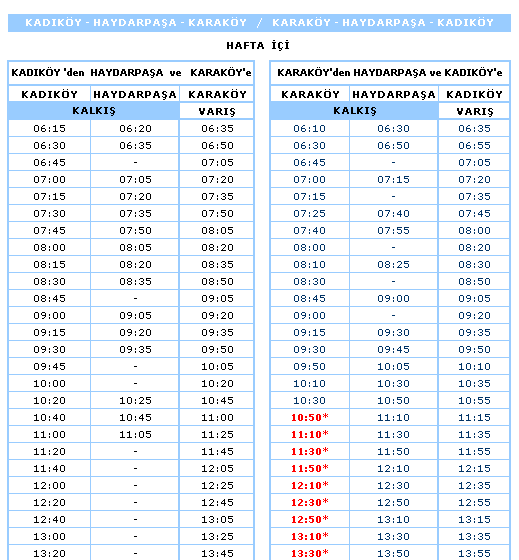
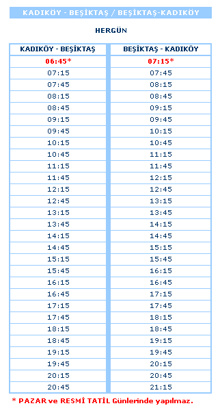

Hi,

Project R is set on the Kadıköy quay in Istanbul, right in front of the ferry pier, in February 2008. Almost everything that happens on that quay comes off a ferry. A boat comes in, a few hundred people walk off the pier, and the quay fills up. So at some point I had to stop guessing when the ferries came, and find out.

## Why I needed it

The game's day needs a shape. When does the quay fill up? When does it go quiet? When is the last boat? I had put a morning rush at 7 to 9 and an evening rush at 5 to 8. That's what a commuter town feels like, but it was a guess, and the rule for this game is no guesses about 2008 if the real thing can be found. The ferries are run by İDO, not Şehir Hatları. Prices are in YTL. Haydarpaşa still has trains. The timetable should be real too.

## Where it wasn't

Searching for "vapur saatleri 2008" gets you this year's timetables, copied onto a hundred sites, and nothing older. Şehir Hatları's site only has the current one. İDO's site today is about car ferries and sea buses to Yalova and Bursa. Nobody seems to have kept a 2008 timetable.

The key fact is who ran the city ferries back then. In 2008 that was İDO, so the 2008 timetable would have been on İDO's 2008 website.

## Where it was

The Wayback Machine has copies of ido.com.tr from 2007 to 2009. Its search API (the CDX index) lists every archived address under a domain. So instead of clicking through old pages, I asked it for every İDO page between 2007 and 2009, and read the list.

A few things turned up on the way:

- **Old sea bus timetables from 2006.** Bostancı–Kadıköy–Yenikapı–Bakırköy, Yenikapı–Yalova. These are real, but they're sea buses, not the ferries at the Kadıköy pier.
- **The 2009 site's menu.** It had an item called "Şehirhatları Tarifesi", city ferry timetable. Its pages all share one section number, `kapsam=224`.
- **That section number in the 2007 and 2008 copies.** The page I wanted was called "2007-2008 Kış Tarifesi", the 2007–2008 winter timetable. Winter schedules ran from autumn to spring, so it covers February 2008.

The index page linked every line: Kadıköy–Eminönü, Kadıköy–Beşiktaş, Kadıköy–Kabataş, Karaköy–Haydarpaşa–Kadıköy (weekdays, Saturdays and Sundays as separate pages), and the islands line.

Then the line pages came up empty. The page frame was there, menu and all, but no timetable. The archive also had a printable version of each page, saved with `View=2` on the address. Comparing two of those showed why: the only difference between them was one image. The timetables were never text. Each one was a GIF, with names like `2007_2008_kis_sh_kdky_emnonu.gif`.

All but one downloaded on the first try. The one that didn't was the most important one, Kadıköy to Karaköy on weekdays. The archive kept saying "Temporarily Offline", so I waited and tried again. Then I analysed the images and turned them into data, about six hundred times in all. I've kept the original GIFs next to the data, so any time can be checked against its source.

## What Kadıköy looked like in February 2008

From the main pier, four lines.

- **Karaköy, via Haydarpaşa.** The busy one. On weekdays the first boat leaves Kadıköy at 06:15, and one leaves every 15 minutes until 10. Through the day it's every 20 minutes, in the evening every 10 to 15, and after 20:00 every half hour. The last boat leaves Karaköy at 23:00 and gets to Kadıköy at 23:25. In the mornings and late evenings it calls at Haydarpaşa, for the station.
- **Eminönü.** Every 15 minutes until a quarter to ten, then every 20, until 20:00.
- **Beşiktaş.** Every half hour, every day, 06:45 to 20:45 (from 07:15 on Sundays).
- **Kabataş.** Weekdays only, and only at commuter hours: 07:00 to 10:00 and 17:30 to 20:00.

Put them together and the shape of the day is obvious. Between 7:00 and 9:30, and again between 17:00 and 19:30, about twelve boats an hour come in, one every five minutes or so. In the middle of the day it's eight an hour, one every seven or eight minutes. After 23:25 there is nothing at all until a quarter past six.

My guess of 7 to 9 and 5 to 8 turned out to sit right on the real peaks, which was a relief. Now there's a source behind it instead of a feeling.

## Two clocks

This is where it got harder. The timetable runs on real time. The game doesn't.

In the game, one hour takes four real minutes, so one game minute is four real seconds. A day in the game currently covers the afternoon and evening, from a quarter to four to a quarter to eleven, which plays out in 28 minutes. At that pace, "a boat every five minutes" in the rush becomes a boat every twenty seconds.

That alone would be fine if the boats could come and go in a few seconds. For a while they could, and it looked wrong. A ferry slid nine metres sideways off the pier in six seconds, spun at 26 degrees a second and was 300 metres out a minute after its horn. A 49-metre, 600-tonne ferry can't move like that.

So the ferries now move like ships. Every manoeuvre is planned in legs (wait, ahead, astern, sideways, turn on the spot) under real limits: more than a minute to reach full speed, about 200 metres to stop, under five knots going astern, half a metre a second sideways, four degrees a second at most when turning. Coming in, a boat cuts its speed 220 metres out, stops nine metres off the pier, waits three seconds and walks sideways onto the berth. Going out, the lines come off, it walks clear of the pier, backs away, turns on the spot and takes more than a minute to get under way.

Real ship handling takes real time:

- Coming in now takes about 101 seconds, up from 50. That's roughly 25 game minutes.
- Going out, from the horn to 300 metres away, takes 285 seconds, up from 67. That's about 71 game minutes.

So a berth that one boat has just left stays busy for over an hour of game time. The real timetable puts the next boat there in five minutes.

## Fitting one into the other

The pier has three berths. Karaköy's boats lie along the west side, Eminönü's across the end, and Beşiktaş's and Kabataş's along the east side. Each berth has three boats that take its visits in turn, so one can be coming in while another is still backing away. The Karaköy and Eminönü visits are planned first, because they bring the crowds. A boat takes the next visit in the timetable that its berth's water will be clear for, so every boat that comes in arrives at a real time from the 2008 table. The ones that can't fit don't come in, but they're still on the boards.

There was a price, and I measured it on the day I made the change. At the game's pace then, a game minute was two real seconds, and the boats coming in on a weekday dropped from 34 to 21. That's fewer waves of people on the quay, and it's the honest cost of the physics. Since then the clock has slowed to four seconds a minute, so each manoeuvre now blocks a berth for half as many game minutes as it did. I haven't measured the new count yet.

One more thing came out of the two clocks. Sometimes the game's clock stands still while the world keeps going. A boat that was under way at that moment used to freeze on the water, right in front of the quay. Now it carries on to its berth or out of sight in real seconds, and the timetable catches up with it when the clock starts again.

## The boards

Over the pier's two doors there are red LED boards, the kind İDO had over its turnstiles. They show each line's next departure, soonest first: KABATAŞ 14:00, BEŞİKTAŞ 14:15, EMİNÖNÜ 14:20, KARAKÖY 14:30. If a line's boat is already at its berth, its time blinks. The boards read straight from the 2008 timetable, so they list every departure, including the ones no boat in the game could fit in.

## The leftovers

Some small things from the same pages will find their way in. The Eminönü boats that call at Haydarpaşa to pick up station passengers. Kabataş boats only running at rush hour. Beşiktaş keeping the same half-hour beat every day of the week. Probably none of it will be noticed by anyone who wasn't on that quay in 2008. For the people who were, it should feel right.

If you rode these ferries back then and something here doesn't match your memory, I'd love to hear about it.
